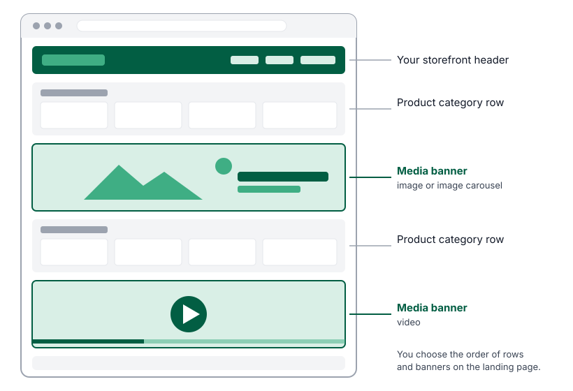
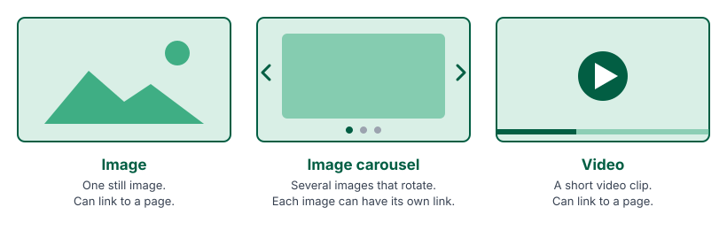
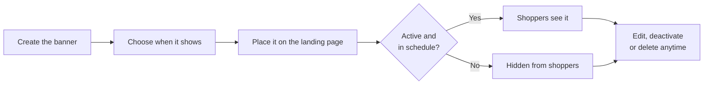

Media banners are images, image carousels and videos that you place on your storefront landing page. Use them to promote deals, new products, events, store news or anything else you want shoppers to notice first.

You create and manage media banners in the Admin Portal under **Marketing** → **Media Banners**. Each banner belongs to one store, and you decide where it sits on that store's landing page and when it appears.

## Who this is for

Dispensary owners and managers who run promotions or look after the online store. You need access to the **Marketing** area of the Admin Portal.

## What shoppers see

Media banners appear on your storefront landing page between your product category rows. You choose their order, so a banner can sit at the top of the page or further down.

Shoppers see a banner only while it is active and, if you scheduled it, only on the dates, days and times you chose. When a banner has a link, selecting it opens that page in a new browser tab. On in-store kiosks, banners are shown but are not clickable, so shoppers stay in your store.

## Types of media banner

| Type | Best for | Links |
|---|---|---|
| **Image** | One clear message, such as a weekly deal or holiday hours. | One link for the image. |
| **Image carousel** | Several related messages, such as three featured brands. Images rotate automatically at the speed you set. | A separate link for each image. |
| **Video** | Product launches, brand stories and in-store events. | One link for the video. |

An image banner is an image carousel with a single image in it, so it doesn't rotate.

## How a media banner works

## Key terms

- **Landing page**: the home page of your storefront, the first page shoppers see.
- **Active / Inactive**: whether the banner can appear on the storefront. An inactive banner is kept in the Admin Portal but never shown.
- **Schedule**: optional dates, days of the week and a daily time window that limit when an active banner appears.
- **Store time**: schedules always follow your store's time zone, not the time zone of the computer you're using.

## Guides

- [Create a media banner](./create-a-media-banner/)
- [Schedule a media banner](./schedule-a-media-banner/)
- [Arrange your landing page](./arrange-your-landing-page/)
- [Manage media banners](./manage-media-banners/)
- [Troubleshooting and FAQ](./troubleshooting/)
