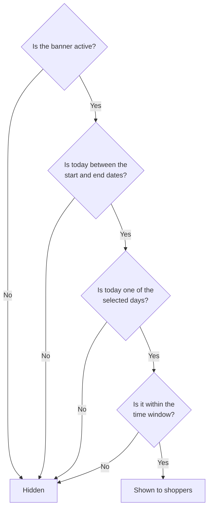

Schedule a media banner when it should only appear at certain times, such as a weekend deal, a holiday notice or a happy-hour promotion. The banner then shows and hides itself, so nobody has to switch it on or off at midnight.

## Before you start

- Decide the **date range**: the first day the banner should appear and, if it should stop, the last day.
- Decide which **days of the week** it should appear on.
- Decide whether it should appear **all day** or only during a **time window**, such as 4:00 PM to 7:00 PM.
- Schedules follow your **store's time zone**, not the time zone of the computer you're using.

## Steps

You set a schedule while [creating a media banner](../create-a-media-banner/), or later by editing an existing banner from its **⋯** menu.

1. In the banner panel, select **Schedule Activation**.
2. In **Start Date**, choose the first day the banner should appear. You can choose today or a future date.
3. *(Optional)* In **End Date**, choose the last day the banner should appear. It must be after the start date. Leave it empty to keep the banner running until you deactivate it.
4. Choose the **days of the week** the banner should appear. All days are selected by default.
5. *(Optional)* To show the banner only during part of the day, turn on **Visible Time Window**, then set **Start Time** and **End Time**. The same time window applies to every day you selected.
6. Select **Save & Close**.

## How Mosaic decides whether to show a scheduled banner

A scheduled banner appears only when every condition is met:

## What to expect

- **Start date is today**: the banner can appear as soon as you save.
- **Start date is in the future**: the banner first appears at midnight store time on the start date, or at the start of the time window if you set one.
- **During the schedule**: the banner appears and disappears automatically according to the days and time window you chose.
- **After the end date**: the banner stops appearing and its status changes to **Inactive**. It stays in your **Media Banners** list, so you can reuse it later by editing the dates.
- **No end date**: the banner keeps following its days and time window until you deactivate it.

:::note
The end time must be later than the start time. If it isn't, **Save & Close** stays unavailable until you correct the times. Because of this, a time window can't run past midnight.
:::

## Examples

| Goal | Start Date | End Date | Days | Visible Time Window |
|---|---|---|---|---|
| Weekend pre-roll deal for November | Friday, November 6 | Sunday, November 29 | Fri, Sat, Sun | Off (all day) |
| Weekday happy hour | Today | *(empty)* | Mon to Fri | 4:00 PM to 7:00 PM |
| Holiday hours notice | December 20 | January 2 | All days | Off (all day) |
| Morning wake-and-bake special | Next Monday | *(empty)* | All days | 8:00 AM to 11:00 AM |

**Weekday happy hour.** Example Dispensary runs a happy hour from 4:00 PM to 7:00 PM, Monday to Friday. Their banner uses today as the start date, no end date, Monday to Friday selected, and a time window of 4:00 PM to 7:00 PM. Shoppers see it only during happy hour; at 7:00 PM it disappears until 4:00 PM the next weekday.

## Related

- [Create a media banner](../create-a-media-banner/)
- [Manage media banners](../manage-media-banners/)
- [Troubleshooting and FAQ](../troubleshooting/)
