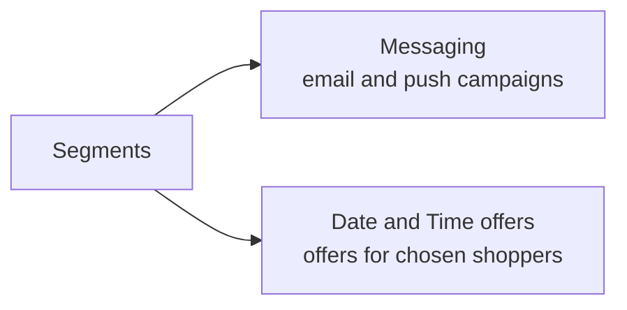

Segments are groups of your registered shoppers, sorted automatically by how and when they shop. Use them to send the right message or offer to the right people, such as welcoming new shoppers or winning back ones you haven't seen in a while.

You'll find them in the Admin Portal under **Marketing** → **Segments**.

## Who this is for

Dispensary owners and managers who run marketing campaigns. You need access to the **Marketing** area of the Admin Portal.

## Your segments

Mosaic sorts your registered shoppers into these segments for you. You don't need to set anything up.

### Shopping-activity segments

These are based on each shopper's purchases over the last six months.

| Segment | Who's in it | Typical use |
|---|---|---|
| **New Users** | Shoppers who registered less than 30 days ago. | Welcome messages, first-order offers. |
| **Butterflies** | Shoppers who buy, on average, twice a month or less. | Nudges to visit more often. |
| **OGs** | Shoppers who buy, on average, more than twice a month. | Thank-you messages, VIP perks. |
| **Win Back** | Shoppers registered for six months or more who haven't bought anything in the last six months. | "We miss you" offers. |

### Profile segments

These are based on details shoppers give in their profile.

| Segment | Who's in it |
|---|---|
| **Senior** | Shoppers above the senior age set for your store, based on the date of birth in their profile. |
| **Veteran** | Shoppers who confirmed they're a veteran when signing up or in their profile. |

:::note
Segment rules are set by Mosaic. You can't edit them in the Admin Portal. If you'd like a segment changed, or a new one added, contact the Mosaic support team.
:::

## Where you can use segments

- **Messaging**: send an email or push notification to one or more segments. See [Target shoppers with segments](./use-segments/).
- **Date and Time offers**: make an offer available only to shoppers in a segment. See [Target shoppers with segments](./use-segments/).

## Good to know

- **Segments update by themselves.** As shoppers place orders or reach six months without one, they move between segments automatically.
- **Only registered shoppers are in segments.** Guests who check out without an account aren't included.
- **A shopper can be in more than one segment**, for example **OGs** and **Veteran**. If you send a message to several segments, each shopper still gets it only once.

## Guides

- [Target shoppers with segments](./use-segments/)
- [Troubleshooting and FAQ](./troubleshooting/)
