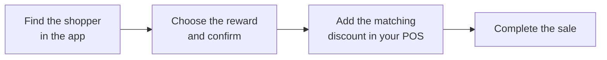

This page is for budtenders. It shows how to make sure shoppers get their points for in-store purchases, and how to apply a reward they want to use.

## Before you start

- The shopper needs a loyalty account. If they don't have one, ask them to sign up on your kiosk, or by scanning your in-store QR code, **before** you complete the sale. Purchases made before they sign up don't earn points.
- Find out how your store redeems rewards. It depends on your POS:
  - **In your POS**: some POS systems show the shopper's points and rewards on screen.
  - **In the Mosaic In-store Rewards app**: for other POS systems. The Mosaic support team gives your store the link and logins.

## Help a shopper earn points

1. In your POS, look up the shopper by the **phone number** they signed up with. If you can't find them, try their **email**.
2. Make sure the right customer is attached to the sale, then complete it as usual.

Points are added to the shopper's balance automatically. They can take up to a day to appear.

:::tip
If a shopper has more than one customer record in your POS, merge them in your POS so all their points land in one place.
:::

## Redeem a reward in your POS

Use this if your POS shows Mosaic rewards.

1. Look up the shopper in your POS and attach them to the sale.
2. Check their points and the rewards they can use.
3. Apply the reward the shopper chooses.
4. Complete the sale. The points are taken from their balance straight away.

## Redeem a reward in the Mosaic In-store Rewards app

Use this if your POS doesn't show Mosaic rewards.

1. Open the Mosaic In-store Rewards app and sign in.
2. Select your store, then select **Let's Go**.
3. Search for the shopper by email or phone number.
4. Select the reward the shopper wants, then select **Yes, Proceed**.
5. In your POS, add the matching loyalty discount to the sale.
6. Complete the sale.

:::caution
Apply each reward once. Submitting the same reward twice takes the points twice.
:::

## What to expect

- Shoppers can use **one reward per order**.
- If the sale is voided or fully returned later, the points spent on the reward go back to the shopper.

## Examples

**Earning.** A shopper says they signed up online last week. The budtender searches the POS by their phone number, attaches them to the sale and completes it. The points show in the shopper's balance by the next day.

**Redeeming with the app.** A shopper wants "$10 off your order". The budtender finds them in the In-store Rewards app, selects the reward, selects **Yes, Proceed**, then adds the $10 loyalty discount in the POS before taking payment.

## Related

- [How loyalty works](../how-loyalty-works/)
- [Create a reward](../create-a-reward/)
- [Troubleshooting and FAQ](../troubleshooting/)
