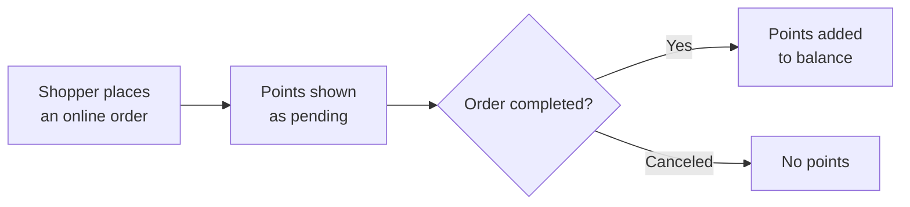

This page explains the rules your shoppers experience, so you can set up your program with confidence and answer their questions.

## Joining

Shoppers join your loyalty program by creating an account:

- **Online**: on your storefront.
- **In store**: on your in-store kiosk, or by scanning a QR code and signing up on their phone before they pay.

A shopper's phone number and email identify them. When they sign up, Mosaic looks for them in your POS using their email, then their phone number, and links the two records. If they're not in your POS yet, a POS customer record is created for them.

:::caution
Purchases made before a shopper signs up don't earn points. Encourage shoppers to sign up before they pay.
:::

## Earning points

- Shoppers earn points on what they actually pay for their products: the subtotal **after** discounts.
- How many points they earn per dollar depends on their loyalty tier. See [Loyalty tiers](#loyalty-tiers).
- **Online orders**: points show as pending at checkout and are added to the shopper's balance when the order is completed, for example when it's picked up.
- **In-store purchases**: points are added when the budtender attaches the shopper's account to the sale. They can take up to a day to appear in the shopper's balance.

## Loyalty tiers

Loyalty tiers reward your best shoppers. The Admin Portal calls them **Levels**.

- You can run a single-tier program, where everyone earns at the same rate, or turn on up to three tiers.
- Each tier has a name, the points a shopper needs to reach it, and its own earning rate.
- Shoppers move up to the next tier when they reach its points.
- You can make [offers](../../marketing/offers/) available only to certain tiers, for example a monthly discount for your top tier.

## Redeeming rewards

**Online**

1. The shopper signs in and adds products to the cart.
2. They open **Apply Offers & Rewards** and choose a reward they have enough points for.
3. The points are held when they check out, and the reward is shown in their order details and confirmation email.

**In store**

The budtender applies the reward at the counter. How they do it depends on your POS. See [Earn and redeem points in store](../earn-and-redeem-in-store/).

**Rules for all rewards**

- Shoppers can use **one reward per order**.
- A reward can be used together with a product or category offer in the same order.

## Cancellations and returns

Points stay accurate when orders change:

- **An online order is canceled before it's completed**: no points are added, and any points held for a reward go back to the shopper.
- **A completed order is voided or fully returned**: the points it earned are taken back, and any points spent on a reward go back to the shopper. This works for online and in-store orders.
- **Part of an order is returned**: the points earned are recalculated for what the shopper kept.

You can check every change in the shopper's points history. See [Manage a shopper's points](../manage-shoppers-points/).

## Sign-up and birthday treats

- **Sign-up and birthday discounts** are offers, not points. Create them under **Marketing** → **Offers**. See [Create an offer](../../marketing/offers/create-an-offer/).
- **Bonus points for signing up** are set by Mosaic. Ask the Mosaic support team if you'd like to give new shoppers points when they join.

## Point expiry

To find out whether points expire in your program, or to change it, contact the Mosaic support team.

## Related

- [Loyalty overview](../)
- [Set up your loyalty program](../set-up-your-loyalty-program/)
- [Create a reward](../create-a-reward/)
- [Earn and redeem points in store](../earn-and-redeem-in-store/)
