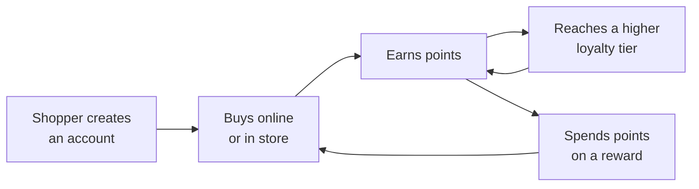

Your loyalty program lets shoppers earn points every time they buy from you, online or in store, and spend those points on rewards such as money off their order or a free product. You can also set up loyalty tiers so your best shoppers earn points faster.

It's your store's own program: you decide how many points shoppers earn and which rewards they can get. You'll find it in the Admin Portal under **Loyalty**, with shoppers' points under **Customers**.

:::note
This section covers your store's own loyalty program. Mosaic Pay & Rewards has a separate points program run by Mosaic, with its own rules.
:::

## Who this is for

- **Owners and managers** who set up the program and its rewards. You need access to the **Loyalty** area of the Admin Portal.
- **Budtenders** who help shoppers earn and redeem points at the counter. See [Earn and redeem points in store](./earn-and-redeem-in-store/).

## What shoppers see

- **Loyalty page**: signed-in shoppers see their points balance and the rewards they can get.
- **Cart**: shoppers choose a reward from **Apply Offers & Rewards**.
- **At the counter**: the budtender finds the shopper, adds their points and applies any reward they choose.

Guests who aren't signed in don't see points or rewards. Encourage them to create an account.

## The program at a glance

## Key terms

- **Points**: what shoppers earn by spending, and spend on rewards.
- **Points per currency**: how many points a shopper earns for each dollar. For example, 1 point per $1, or 0.5 points per $1 (1 point for every $2).
- **Loyalty tier**: a level shoppers reach by earning points. Each tier can earn points at a different rate. The Admin Portal calls these **Levels**.
- **Reward**: money off an order, or a product, that a shopper gets in exchange for points.
- **Offer**: a discount set up under **Marketing** → **Offers**. Offers don't cost points, but you can limit them to certain loyalty tiers. See [Offers](../marketing/offers/).

## Guides

- [How loyalty works](./how-loyalty-works/)
- [Set up your loyalty program](./set-up-your-loyalty-program/)
- [Create a reward](./create-a-reward/)
- [Earn and redeem points in store](./earn-and-redeem-in-store/)
- [Manage a shopper's points](./manage-shoppers-points/)
- [Troubleshooting and FAQ](./troubleshooting/)
