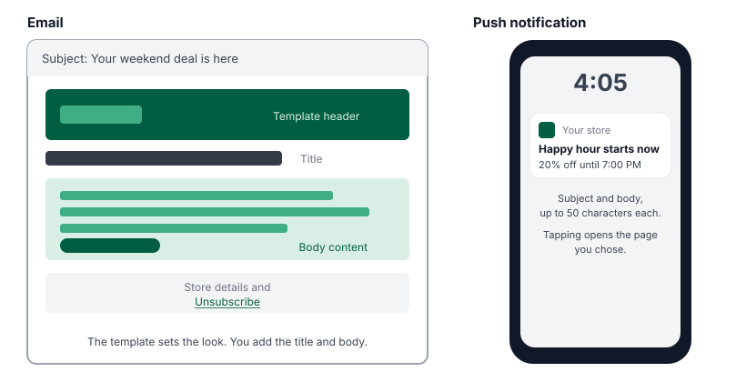
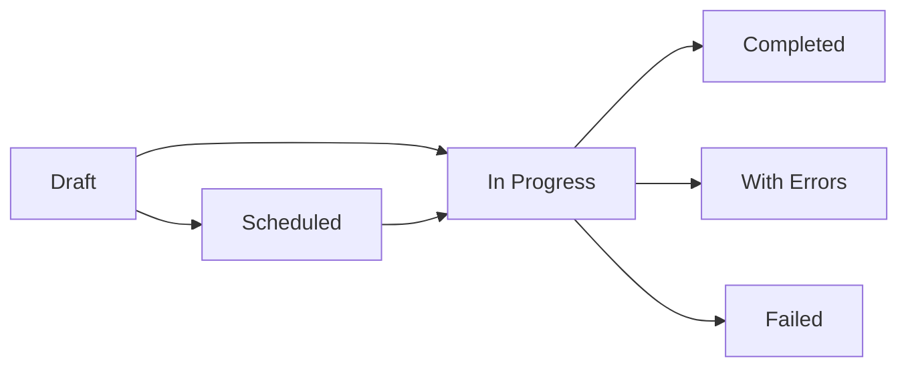

Messaging lets you send marketing emails and push notifications to your registered shoppers. Use it to announce deals, new products, events and store news, to everyone or to selected segments and loyalty tiers.

You'll find it in the Admin Portal under **Marketing** → **Messaging**.

## Who this is for

Dispensary owners and managers who run marketing campaigns. You need access to the **Marketing** area of the Admin Portal.

## What shoppers receive

| Channel | What it looks like | Who receives it |
|---|---|---|
| **Email** | A branded email built from one of your store's email templates, with your title and body content. Every email includes an unsubscribe link. | Registered shoppers in your chosen audience who haven't unsubscribed. |
| **Push notification** | A short notification on the shopper's phone or device with a subject and body. Tapping it opens the storefront page you chose. | Registered shoppers in your chosen audience who have allowed notifications. |

You can send by email, by push, or both in the same message.

## How a message moves through Mosaic

| Status | Meaning |
|---|---|
| **Draft** | Saved but not sent. You can keep editing it. |
| **Scheduled** | Will send automatically at the date and time you chose. |
| **In Progress** | Sending now. Large audiences are sent in batches, so this can take a while. |
| **Completed** | Sent to all recipients. |
| **With Errors** | Sent, but some messages couldn't be delivered. |
| **Failed** | Couldn't be sent. The reason is shown with the message. |

## Key terms

- **Recipients**: who the message goes to: all registered shoppers, or selected [segments](../segments/) and loyalty tiers.
- **Stored email template**: the design your email uses, such as your logo, colors and footer. The templates available depend on your store.
- **Admin preview email**: a test copy sent to your team before the real send.
- **Store time**: scheduled messages send at the date and time you choose in your store's time zone.

## Guides

- [Create and send a message](./create-a-message/)
- [Manage messages](./manage-messages/)
- [Troubleshooting and FAQ](./troubleshooting/)
