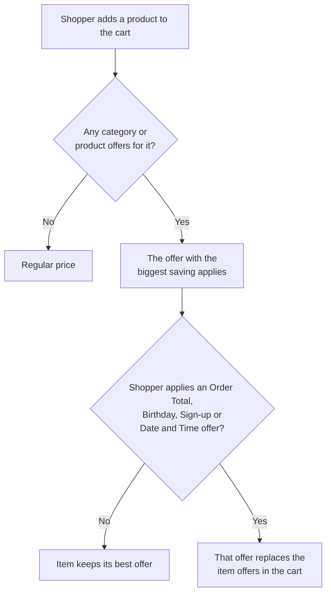

Offers are discounts your shoppers can use when they order online. You can discount categories or products, reward a big basket, celebrate birthdays and sign-ups, target specific segments, and show your in-store deals on the storefront.

You'll find them in the Admin Portal under **Marketing** → **Offers**.

## Who this is for

Dispensary owners and managers who plan promotions. You need access to the **Marketing** area of the Admin Portal.

## What shoppers see

- **Specials page**: every current offer appears as a card. Offers for registered shoppers only are labeled as such.
- **Product cards and product pages**: products with an offer show an offer tag and the discounted price next to the original, struck-through price.
- **Cart**: category and product offers apply automatically. Shoppers can open **Apply Offers & Rewards** to choose other offers, or enter a promo code.

## Offer types

| Offer type | What it does | Who can use it | Applied |
|---|---|---|---|
| **Category** | A $ or % discount on products in the categories you choose. | All shoppers, or registered shoppers and loyalty tiers. | Automatically |
| **Product** | A $ or % discount on the products you choose, optionally with a minimum quantity. | All shoppers, or registered shoppers and loyalty tiers. | Automatically |
| **Order Total** | A $ or % discount on the whole order above a minimum order total. | All shoppers, or registered shoppers and loyalty tiers. | Shopper chooses it in the cart |
| **Birthday** | A one-time discount during the shopper's birthday month, with an email on the first day of the month. | Registered shoppers | Shopper chooses it in the cart |
| **Sign-up** | A one-time discount for new shoppers, valid for a set number of days after they register. | Registered shoppers | Shopper chooses it in the cart |
| **Date and Time** | A discount for a [segment](../segments/) or a list of shoppers, optionally limited to certain days and hours. | Registered shoppers you target | Shopper chooses it in the cart |
| **POS offer** | A card on the Specials page that promotes a deal you run in your POS. Display only. | Everyone | In store, by your POS |

## How a discount is chosen

Read more in [How offers apply in the cart](./how-offers-apply/).

## Key terms

- **Audience**: who can use the offer: **All Users** (guests and registered shoppers) or **Registered Users**, optionally narrowed to loyalty tiers.
- **Redemption**: how often one shopper can use the offer: once, once per day or multiple times.
- **Promo code**: an optional code shoppers can type in the cart to apply the offer.
- **Start and end**: offers switch on and off by themselves at the start and end you set. These times are in UTC. See [Manage offers](./manage-offers/).

## Guides

- [Create an offer](./create-an-offer/)
- [How offers apply in the cart](./how-offers-apply/)
- [Manage offers](./manage-offers/)
- [Troubleshooting and FAQ](./troubleshooting/)
